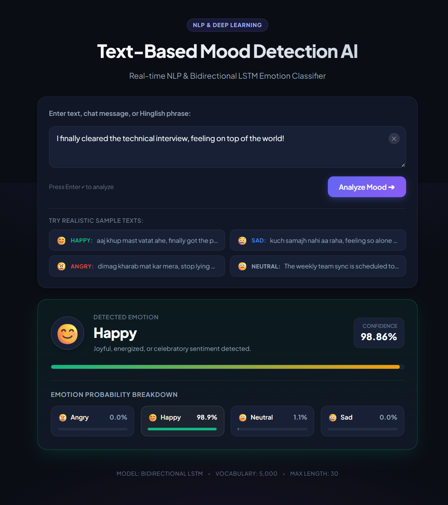

# 🧠 Text-Based Mood Detection AI

[](https://www.python.org/)
[](https://tensorflow.org/)
[](https://fastapi.tiangolo.com/)
[](https://developer.mozilla.org/en-US/docs/Web/HTML)
[](https://developer.mozilla.org/en-US/docs/Web/CSS)
[](https://developer.mozilla.org/en-US/docs/Web/JavaScript)
[](https://github.com/)

An end-to-end full-stack Artificial Intelligence application that detects human emotions and sentiments from conversational text. Powered by an NLP preprocessing pipeline, a Bidirectional Long Short-Term Memory (Bi-LSTM) deep neural network in TensorFlow, a high-throughput FastAPI inference server, and a zero-dependency modern HTML/CSS/JavaScript interface.

---

## 📸 Application Preview

> Place your application screenshot in `assets/demo.png` to display your UI preview here.



---

## 🌟 Key Features

- **Multilingual & Colloquial Support**: Trained to classify standard English, modern social media chat abbreviations, **Hinglish**, and natural **Romanized Marathi** (e.g., *"aaj khup mast vatat ahe"*, *"mala khup rag aala ahe"*, *"dimag kharab mat kar"*, *"dokyala tap deu nakos"*). Handles intense emotional expressions and aggressive prompts accurately.
- **Context-Aware Content Moderation Guardrail**: Clean 2-outcome safety evaluation keeping the application strictly focused on emotion classification without unwanted external helpline numbers or support banners:
  - **Flagged (`flagged: true`)**: Blocks only explicit vulgar profanity/slurs (English, Hindi, Marathi gaali) and actionable illegal/violent intent (weapons creation, terrorism recruitment, cyberattacks, drug distribution).
  - **Allowed (`flagged: false`)**: Passes natural conversational text directly to the neural network, including grief and sorrow (*"mazya mitrane suicide kele"* → `Sad`), law enforcement/news mentions (*"mi kal ek terrorist pakadla"* → `Neutral`), and expressive anger (*"i hate you"*, *"dimag kharab mat kar"*, *"i kill you"* → `Angry`).
- **Deep Learning Bi-LSTM Architecture with EarlyStopping**: Captures bidirectional contextual semantics across past and future tokens in text sequences using a 64-dimensional Embedding space and 32-unit Bidirectional LSTM layers with Dropout regularization (0.3) and `EarlyStopping` monitoring validation loss to prevent overfitting.
- **Robust NLP Preprocessing**: End-to-end token cleaning pipeline using lowercasing, regex-based punctuation removal, and NLTK WordNet lemmatization.
- **Production-Ready FastAPI Server**: Asynchronous, lightweight backend featuring CORS configuration, auto-loading model weights via lifespan events, health monitoring, and structured JSON payloads.
- **Zero-Dependency Modern Frontend**:
  - Pure HTML5, CSS3, and ES6+ JavaScript—**no Node.js, npm, or external build tools required**.
  - Live prediction confidence scores with smooth progress meters.
  - Granular probability distribution breakdown across all 4 target emotions (`Happy`, `Sad`, `Angry`, `Neutral`).
  - Contextual mood-based theme accents (Emerald for Happy, Sapphire for Sad, Crimson for Angry, Slate for Neutral).
  - One-click sample test chips for immediate testing.

---

## 🛠️ Tech Stack

### Machine Learning & Backend
- **Python 3.9+**
- **TensorFlow / Keras**: Bidirectional LSTM deep neural network architecture.
- **NLTK (Natural Language Toolkit)**: WordNet lemmatizer & text normalization.
- **Scikit-Learn**: Dataset stratification, validation splits, and label encoding.
- **Pandas & NumPy**: Dataset curation, tensor transformations, and sequence padding.
- **FastAPI & Uvicorn**: Asynchronous REST API inference engine.

### Frontend (Zero Dependencies)
- **HTML5**: Semantic and accessible markup.
- **CSS3**: Modern responsive glassmorphic layout, dynamic color schemes, and micro-interactions without heavy CSS libraries.
- **Modern JavaScript (ES6+)**: Native `fetch` API, asynchronous request handling, and dynamic DOM manipulation.

---

## 🗂️ Folder Structure

```
Text-Mood-Detection-AI/
├── .gitignore
├── README.md
├── assets/
│   └── demo.png                     # Application screenshot placeholder
├── backend/
│   ├── app.py                       # FastAPI application & REST endpoints
│   ├── requirements.txt             # Backend Python dependencies
│   ├── train.py                     # NLP preprocessing & Bi-LSTM training pipeline
│   ├── data/
│   │   └── mood_dataset.csv         # 450+ balanced samples (English, Hinglish & Marathi)
│   └── model/
│       ├── .gitkeep
│       ├── mood_bilstm.keras        # Trained Keras model (generated after training)
│       ├── tokenizer.pkl            # Pickled Keras Tokenizer (generated after training)
│       └── label_encoder.pkl        # Pickled Scikit-Learn LabelEncoder
└── frontend/
    ├── index.html                   # Modern web UI structure & sample chips
    ├── style.css                    # Glassmorphism, animations & dynamic mood accents
    └── script.js                    # Fetch requests, event handlers & DOM updates
```

---

## 📐 Model Architecture

```
Layer (type)                     Output Shape          Param #
=================================================================
embedding (Embedding)            (None, 30, 64)        320,000  (Vocab: 5000)
bidirectional (Bidirectional)    (None, 64)            24,832   (LSTM 32 units)
dropout (Dropout)                (None, 64)            0        (Rate: 0.3)
dense (Dense)                    (None, 32)            2,080    (Activation: ReLU)
dense_1 (Dense)                  (None, 4)             132      (Activation: Softmax)
=================================================================
Total params: 347,044
Optimizer: Adam | Loss: Categorical Crossentropy | Metric: Accuracy
```

---

## 🚀 Local Setup & Run Guide

### 1. Clone the Repository
```bash
git clone https://github.com/your-username/Text-Mood-Detection-AI.git
cd Text-Mood-Detection-AI
```

---

### 2. Backend Setup & Training

#### a. Create & Activate Virtual Environment
**On Windows (PowerShell):**
```powershell
python -m venv venv
.\venv\Scripts\Activate.ps1
```

**On macOS / Linux:**
```bash
python3 -m venv venv
source venv/bin/activate
```

#### b. Install Dependencies
```bash
cd backend
pip install -r requirements.txt
```

#### c. Train the Bi-LSTM Model
Train the neural network and export the serialized artifacts (`mood_bilstm.keras` and `tokenizer.pkl`):
```bash
python train.py
```
> The model will train across the balanced dataset and save the trained weights into `backend/model/`.

#### d. Start the FastAPI Server
```bash
uvicorn app:app --host 0.0.0.0 --port 8000 --reload
```
The backend server will run at **`http://localhost:8000`**.  
Interactive Swagger API documentation is available at **`http://localhost:8000/docs`**.

---

### 3. Frontend Setup (No Node.js Required)

In a separate terminal window, serve the `frontend/` folder using Python's built-in HTTP server:

```bash
cd frontend
python -m http.server 3000
```

Open your browser and navigate to:
**`http://localhost:3000`**

*(Alternatively, you can open `frontend/index.html` directly in any web browser.)*

---

## 📡 API Specification

### 1. Health Check
- **Endpoint**: `GET /health`
- **Response**:
```json
{
  "status": "ok",
  "model_loaded": true
}
```

### 2. Predict Mood
- **Endpoint**: `POST /predict`
- **Headers**: `Content-Type: application/json`

#### a. Standard Classification (Allowed)
- **Request Body**:
```json
{
  "text": "aaj khup mast vatat ahe, finally got promoted!"
}
```

- **Response Body**:
```json
{
  "mood": "Happy",
  "confidence": 98.45,
  "emoji": "😊",
  "flagged": false,
  "probabilities": {
    "Angry": 0.0031,
    "Happy": 0.9845,
    "Neutral": 0.0082,
    "Sad": 0.0042
  }
}
```

#### b. Moderation Guardrail (Flagged)
- **Request Body**:
```json
{
  "text": "how to make a bomb"
}
```

- **Response Body**:
```json
{
  "mood": "Flagged",
  "confidence": 100.0,
  "emoji": "⚠️",
  "flagged": true,
  "warning": "Inappropriate or harmful intent detected. Please enter respectful text.",
  "probabilities": {}
}
```

---

## 📊 Dataset Breakdown

The dataset (`backend/data/mood_dataset.csv`) contains **480 balanced samples** (120 per class) across four emotional categories, blending standard English, Hinglish, and Romanized Marathi:

| Class | Count | Sample Characteristics |
|---|---|---|
| **Happy** | 120 | Celebrations, excitement, gratitude, Hinglish & Marathi colloquialisms (*"khup bhari vatat ahe"*, *"ekdum mast"*, *"man prasanna ahe"*, *"party"*, *"sorted"*) |
| **Sad** | 120 | Grief, loneliness, regret, academic/work burnout, depression, Marathi expressions (*"khup vait vatat ahe"*, *"man udas ahe"*, *"tras hoto ahe"*, *"dukhi"*) |
| **Angry** | 120 | Strong aggression, frustration, confrontation, threats (*"i will kill you"*, *"mar dalunga"*, *"mala khup rag aala ahe"*, *"dokyala tap deu nakos"*, *"shut up"*) |
| **Neutral** | 120 | Scheduling, logistics, technical queries, daily routines (*"mi abhyas kartoy"*, *"udya lecture ahe"*, *"meeting is at 10 am"*, *"lecture normal zala"*) |

---

## 👨‍💻 Author

**Aniket More**  
- GitHub: [@your-username](https://github.com/)  
- LinkedIn: [Aniket More](https://linkedin.com/)  

---

## 📄 License

This project is licensed under the [MIT License](LICENSE).
